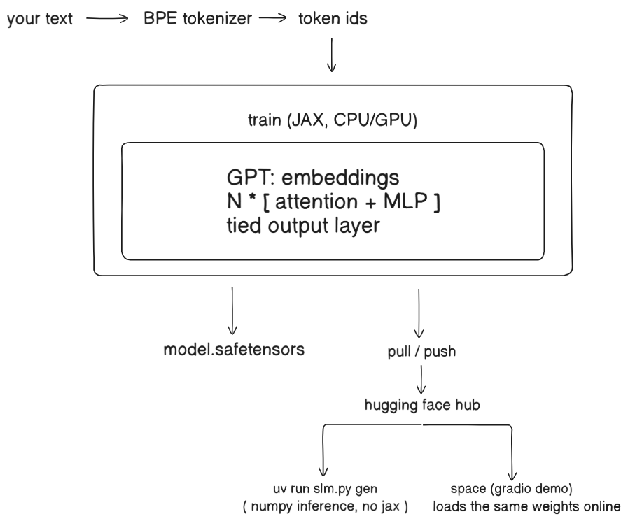

<h1 align="center">my-slm-node</h1>
<p align="center">
 a small language model you train whenever you want, keep on Hugging Face, and pull or run anywhere. The Node.js / npm twin of <code>my-slm</code> (Python).
</p>

<p align="center">
  <a href="#setup"></a>
  <a href="#training"></a>
  <a href="#hugging-face"></a>
  <a href="#using-my-slm-node"></a>
</p>


> **⚠️ Honest framing.** This is a from-scratch GPT-style model, small enough to train on a laptop. The demo model in this zip has **3.06M parameters, was trained for 28 minutes on 2 CPU cores on WikiText-2, and does not know facts** (it writes Wikipedia-looking text that is mostly nonsense). A model this small cannot beat large models; it is for learning, narrow tasks you train on your own text, and a pipeline you can reuse. **Training in Node is about 10x slower than the Python version** (about 485 tokens/sec against about 4,800 on the same 2 cores), because it runs on WebAssembly. Generating text is fast and needs no packages. The Hugging Face upload, pull and Space steps, the optional native engine (`@tensorflow/tfjs-node`) and **Windows** were **not tested** in the build environment (the site and the native download were blocked there, and it was Linux). Everything else was tested, and is listed in [Testing](#testing).


## Table of contents

1. [Setup](#setup)
2. [Using my-slm-node](#using-my-slm-node)
3. [What is in the zip](#what-is-in-the-zip)
4. [Training](#training)
5. [Hugging Face](#hugging-face)
6. [Works with the Python version](#works-with-the-python-version)
7. [Architecture](#architecture)
8. [Model size and speed](#model-size-and-speed)
9. [Choosing your data](#choosing-your-data)
10. [Commands and options](#commands-and-options)
11. [Testing](#testing)
12. [Troubleshooting](#troubleshooting)


## Setup

You need **Node 18.17 or newer** (tested on Node 22). Open a terminal in this folder.

```bash
# 1. install the packages (needed for train / push / pull / space)
npm install

# 2. try the demo model (no packages, no account, no training)
node slm.mjs gen --dir demo-model " = The history of" --tokens 60
```

| What you want | What you need |
|---|---|
| Generate text or run the web page | Nothing. `gen` and `serve` use **no npm packages** |
| Train on your own text | `npm install` and a text file. No account needed with `--no-push` |
| Store the model online and pull it later | A free Hugging Face account and a **Write** token (`HF_TOKEN`) |
| A free web demo anyone can open | The same token. The demo runs as a Docker Space |
| Faster training (optional) | `npm install @tensorflow/tfjs-node`. It is used automatically when present. **Untested** |

Commands can be written as `node slm.mjs <command>` or `npm run <command> -- <options>`.


## Using my-slm-node

| Goal | Command |
|---|---|
| Generate from the demo model | `node slm.mjs gen --dir demo-model "Once upon a time" --tokens 60` |
| Train locally, no upload | `node slm.mjs train --data mytext.txt --steps 300 --no-push` |
| Generate from your trained model | `node slm.mjs gen "Once upon a time"` |
| Train and push to Hugging Face | `node slm.mjs train --repo YOURNAME/my-slm --data mytext.txt --steps 1000` |
| Continue training later | Run the same command again with more data. It pulls the existing model first |
| Start over | Add `--fresh` |
| Download your model on another machine | `node slm.mjs pull --repo YOURNAME/my-slm` |
| Generate straight from the Hub | `node slm.mjs gen --repo YOURNAME/my-slm "Your prompt"` |
| Local web page with a prompt box | `node slm.mjs serve --dir model` then open http://localhost:7860 |
| Put it online | `node slm.mjs space --repo YOURNAME/my-slm --space YOURNAME/my-slm-demo` |

**Things to try**

- Train on one book for a few hundred steps, then generate. The style of the book appears even though the facts are wrong.
- Train in Node, push, then continue training the same repo with the Python version (or the other way round).
- Run `serve` and use the model from a browser or from your own Node app via `POST /generate`.


## What is in the zip

| File | What it is |
|---|---|
| `slm.mjs` | The whole toolkit in one file: train, resume, push, pull, generate, serve, deploy a Space |
| `package.json` | Dependencies and `npm run` shortcuts |
| `demo-model/` | The demo model (12 MB): `model.safetensors`, `config.json`, `tokenizer.json` |
| `README.md` | This file |

After training, `slm.mjs` writes a `model/` folder (the same files the Python version writes):

| File | What it is |
|---|---|
| `model.safetensors` | Weights in full precision (used for resuming training) |
| `config.json` | Size settings, steps done, tokens seen, last validation loss |
| `tokenizer.json` | The tokenizer. Made on the first run and **never changed** after that |
| `slm.mjs`, `README.md` | Copied in so the Hub repo is self-contained |


## Training

| Step | What happens |
|---|---|
| 1 | Reads your text (or downloads the WikiText-2 demo corpus if you give none) |
| 2 | First run only: trains a byte-level BPE tokenizer on it. Later runs reuse the saved one |
| 3 | Cuts the tokens 95% / 5% into training and validation |
| 4 | Trains with AdamW, a warm-up and cosine learning rate, and gradient clipping (the same recipe as the Python version) |
| 5 | Prints training loss, plus validation loss and perplexity every 100 steps, and saves a checkpoint each time |
| 6 | Writes the `model/` folder, then pushes it to Hugging Face if you gave `--repo` |

Each batch is split into **micro-batches** (`--micro 8`) and their gradients are added up. The result is the same as one big batch, but it needs far less memory, which WebAssembly requires (the default settings crash without it). Lower `--micro` if you run out of memory.

When you **resume**, the weights carry over but the optimiser and the learning-rate schedule start fresh.

If a push fails (no internet, wrong token), the model is already saved in `model/`. Fix the problem and run the train command again, or upload the folder from the Hugging Face website.


## Hugging Face

1. Make a free account at huggingface.co.
2. Settings, Access Tokens, create a token with **Write** permission.
3. Put it in your terminal:

```bash
export HF_TOKEN=hf_xxxxx        # Mac / Linux
set HF_TOKEN=hf_xxxxx           # Windows Command Prompt
$env:HF_TOKEN="hf_xxxxx"        # Windows PowerShell
```

If you ran `huggingface-cli login` before, the saved token is found automatically.

| Command | What it does on the Hub |
|---|---|
| `train --repo USER/NAME` | Creates the model repo if needed, uploads the folder after training |
| `train --repo USER/NAME --private` | Same, but the repo is private |
| `pull --repo USER/NAME` | Downloads the whole repo into `./model` |
| `space --repo USER/NAME --space USER/DEMO` | Creates a Docker Space that runs `slm.mjs serve` and shows a prompt box |

For a **private** model repo, add `HF_TOKEN` as a secret in the Space settings so the Space can download it.


## Works with the Python version

The Node and Python versions read and write the **same files**: the same safetensors weights, the same `config.json`, the same `tokenizer.json`. One Hugging Face repo can be trained with either.

| Check | Result |
|---|---|
| Node reads a Python-made `tokenizer.json` | Same token ids as Python on 3 test texts, including emoji and Japanese |
| Python reads a Node-made `tokenizer.json` | Loads, and gives the same ids |
| Node generates from a Python-trained model | Logits agree to about 5e-7; greedy output identical for 40 tokens |
| Python generates from a Node-trained model | Greedy output identical (tiny and default size) |
| Node resumes a Python model, Python resumes a Node model | Both work; the loss keeps falling |

Outputs from random sampling will differ between the two (different random generators); greedy output (`--temp 0`) is identical.


## Architecture




| Part | Choice |
|---|---|
| Model | Decoder-only transformer, learned positions, pre-layer-norm, GELU, tied embeddings (identical to the Python version) |
| Tokenizer | Byte-level BPE written in plain JavaScript (trainer, encoder, decoder). 4096 tokens by default |
| Training | TensorFlow.js on WebAssembly. Gradients for the embedding, the cross-entropy and the matrix products are written by hand to avoid slow or missing kernels. Uses `@tensorflow/tfjs-node` instead if installed |
| Inference | Plain JavaScript with a key/value cache. No packages, no GPU |
| Sampling | Temperature, top-k, top-p and a repetition penalty |
| Weights format | safetensors (safe to load, no code runs) |


## Model size and speed

Measured on 2 CPU cores, Linux, Node 22.

| Setting | Value |
|---|---|
| Parameters (default) | 3.06M (D=192, 5 layers, 3 heads, context 256) |
| Weights on disk | 12.2 MB full precision |
| Training speed, default model | about 485 tokens/sec (one step of 32 x 256 tokens takes about 17 seconds) |
| Training speed, tiny model (0.17M) | about 1,470 tokens/sec |
| Python version, same machine | about 4,800 tokens/sec |
| Generation speed | roughly 100 to 500 tokens/sec depending on size and load |

At the default size, **1000 steps takes about 4.7 hours** in Node (28 minutes in Python). Practical options:

| If you want | Do this |
|---|---|
| A quick test | `--steps 50 --B 8` |
| A real run | Use a smaller model (`--D 128 --L 4 --H 2`), fewer steps, or train with the Python version on Colab and use the result in Node |
| Faster Node training | Try `npm install @tensorflow/tfjs-node` (untested here) |

To make a bigger model, raise the size on the **first** training run (the size is then fixed for that repo). These sizes are estimates, not tested:

| Parameters | Roughly | Full precision on disk |
|---|---|---|
| 3M | `--D 192 --L 5 --H 3` | 12 MB |
| 25M | `--D 512 --L 8 --H 8` | 100 MB |

Knowledge comes from **parameters and data**. More steps on a tiny model will not make it know facts.


## Choosing your data

| Data | Result |
|---|---|
| One book or one author | Learns the style and vocabulary quickly |
| Your own notes or chat logs | A model that imitates that format |
| Many mixed sources | Needs a bigger model and many more steps |
| Under about 1 MB | Too little. It memorises instead of learning |

Pass several files with `--data a.txt b.txt c.txt`. Plain UTF-8 text works. Check that you are allowed to train on what you use.


## Commands and options

| Option (`train`) | Default | Meaning |
|---|---|---|
| `--repo` | none | Hugging Face repo `USER/NAME` to pull from and push to |
| `--dir` | `model` | Local folder for the model |
| `--data` | WikiText-2 | One or more text files |
| `--steps` | 1000 | Training steps this run |
| `--B` / `--T` | 32 / 256 | Batch size / context length |
| `--micro` | 8 | Sequences per micro-batch (lower = less memory) |
| `--D` `--L` `--H` | 192 / 5 / 3 | Width, layers, heads (first run only) |
| `--vocab` | 4096 | Tokenizer size (first run only) |
| `--lr` | 0.002 | Peak learning rate |
| `--eval-every` | 100 | Steps between validation and checkpoint |
| `--fresh` | off | Ignore any existing model |
| `--no-push` | off | Train and save locally only |
| `--private` | off | Create the Hub repo as private |

| Option (`gen`) | Default | Meaning |
|---|---|---|
| `--tokens` | 100 | How much to write |
| `--temp` | 0.8 | Lower is safer, higher is wilder (0 = always the top choice) |
| `--top_k` | 40 | Only choose from the 40 likeliest tokens |
| `--seed` | random | Fix it to repeat the same output |
| `--dir` / `--repo` | `model` / none | Where the model is / pull it from the Hub first |

`serve` takes `--dir`, `--repo` and `--port` (default 7860). It answers `POST /generate` with `{"prompt": "...", "tokens": 100, "temp": 0.8}` and returns `{"text": "..."}`.


## Testing

Checked while building (Linux, Node 22):

| Area | Covered |
|---|---|
| Tokenizer | Node and Python give the same ids and the same decoded text, in both directions |
| Inference | Logits match the Python model to about 5e-7; greedy generation identical |
| Training maths | The TensorFlow.js forward pass matches the inference code (7e-7); the loss matches a manual calculation; 60 sampled gradient entries match finite differences (worst relative error 0.4%) |
| Training | Fresh run at tiny and default size; loss starts at ln(vocab) and falls; same loss as Python after 50 steps on the same data (5.79 vs 5.79) |
| Resume | Node resumes its own model and a Python model; Python resumes a Node model |
| Web server | `serve` answers the page and `POST /generate` |
| Hub push, pull, Space | Code reaches the network call; the upload itself is **not** tested (the site was blocked in the build environment) |
| `@tensorflow/tfjs-node` | **Not tested** (its native download was blocked) |
| Windows, macOS | **Not tested** |


## Troubleshooting

| Problem | Fix |
|---|---|
| `this command needs the Hugging Face package` / `training needs TensorFlow.js` | Run `npm install` in this folder |
| `Aborted()` or an out-of-memory crash while training | Lower `--micro` (try 2) and/or `--B` |
| Training is very slow | Expected on a CPU in Node. See [Model size and speed](#model-size-and-speed) |
| `could not reach huggingface.co` | No internet, or a firewall. The model is still saved in `model/` |
| `401` / `403` from Hugging Face | The token is missing, read-only, or not set in this terminal. Use a **Write** token |
| `not enough text` | Give a bigger file or lower `--T` |
| Output is gibberish | Expected for tiny models and little data. Train on more, cleaner text |
| Pulled model will not load | Make sure `config.json`, `model.safetensors` and `tokenizer.json` are all in the folder |
| Want to change model size | Start a new repo (or use `--fresh`). Size is fixed once a model exists |
