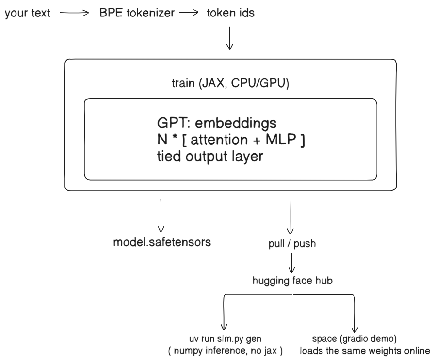

<h1 align="center">my slm</h1>
<p align="center">
 a small language model you train whenever you want, keep on Hugging Face, and pull or run anywhere.
</p>

<p align="center">
  <a href="#setup"></a>
  <a href="#hugging-face"></a>
  <a href="#setup"></a>
  <a href="#using-my-slm"></a>
</p>


> **⚠️ Honest framing.** my slm is a from-scratch GPT-style model, small enough to train on a laptop. The demo model in this zip has **3.06M parameters and was trained for 28 minutes on 2 CPU cores on WikiText-2**. It writes Wikipedia-looking text but **does not know facts** (ask it for the capital of France and you get gibberish). A model this small cannot beat large models; it is for learning, for narrow tasks you train on your own text, and for a pipeline you can reuse. The Hugging Face upload, pull and Space steps have **not been tested against the real Hugging Face site in the build environment** (it was blocked there); training, resuming, saving and generating were tested.


## Table of contents

1. [Setup](#setup)
2. [Using my slm](#using-my-slm)
3. [What is in the zip](#what-is-in-the-zip)
4. [Training](#training)
5. [Hugging Face](#hugging-face)
6. [Architecture](#architecture)
7. [Model size and speed](#model-size-and-speed)
8. [Choosing your data](#choosing-your-data)
9. [Commands and options](#commands-and-options)
10. [Testing](#testing)
11. [Troubleshooting](#troubleshooting)


## Setup

You need **Python 3.10+** and [uv](https://docs.astral.sh/uv/). `uv` reads the dependency list inside each script and installs it for you, so there is no `pip install` step.

```bash
# 1. install uv (once)
curl -LsSf https://astral.sh/uv/install.sh | sh                          # Mac / Linux
powershell -c "irm https://astral.sh/uv/install.ps1 | iex"               # Windows

# 2. unzip and go into the folder
unzip my-slm.zip
cd my-slm

# 3. try the demo model (no account, no training)
uv run run.py "The history of" --tokens 60
```

| What you want | What you need |
|---|---|
| Run the demo model | Nothing else |
| Train on your own text | A text file. No account needed with `--no-push` |
| Store the model online and pull it later | A free Hugging Face account and a **Write** token (`HF_TOKEN`) |
| A free web demo anyone can open | The same token. The demo runs as a Hugging Face Space |
| Faster training | A GPU (Colab or Kaggle) and `uv run --with "jax[cuda12]" slm.py ...` |


## Using my slm

| Goal | Command |
|---|---|
| Generate from the demo model | `uv run run.py "The history of" --tokens 60` |
| Train locally, no upload | `uv run slm.py train --data mytext.txt --steps 1000 --no-push` |
| Generate from your trained model | `uv run slm.py gen "Once upon a time"` |
| Train and push to Hugging Face | `uv run slm.py train --repo YOURNAME/my-slm --data mytext.txt --steps 2000` |
| Continue training later | Run the same command again with more data. It pulls the existing model first |
| Start over | Add `--fresh` |
| Download your model on another machine | `uv run slm.py pull --repo YOURNAME/my-slm` |
| Generate straight from the Hub | `uv run slm.py gen --repo YOURNAME/my-slm "Your prompt"` |
| Put it online | `uv run slm.py space --repo YOURNAME/my-slm --space YOURNAME/my-slm-demo` |

**Things to try**

- Train on one book for 1000 steps, then generate. Text in the book's style appears even though the facts are wrong.
- Train, push, then run `pull` on a different computer and keep going from where you stopped.
- Train on notes in one narrow format (recipes, chat logs, code comments) and compare it with the demo model.


## What is in the zip

| File | What it is |
|---|---|
| `slm.py` | The whole toolkit: train, resume, push, pull, generate, deploy a demo Space |
| `run.py` | Stand-alone runner for the demo model (needs only numpy and tokenizers) |
| `model_int8.npz` | The demo weights, 2.9 MB, int8 |
| `tokenizer.json` | The demo model's tokenizer (4096-token BPE) |
| `README.md` | This file |

After training, `slm.py` writes a `model/` folder:

| File | What it is |
|---|---|
| `model.safetensors` | Weights in full precision (used for resuming training) |
| `config.json` | Size settings, steps done, tokens seen, last validation loss |
| `tokenizer.json` | The tokenizer. Made on the first run and **never changed** after that |
| `slm.py`, `README.md` | Copied in so the Hub repo is self-contained |


## Training

| Step | What happens |
|---|---|
| 1 | Reads your text (or downloads the WikiText-2 demo corpus if you give none) |
| 2 | First run only: trains a BPE tokenizer on it. Later runs reuse the saved one |
| 3 | Cuts the tokens 95% / 5% into training and validation |
| 4 | Trains with AdamW, a warm-up and cosine learning rate, and gradient clipping |
| 5 | Prints training loss, plus validation loss and perplexity every 100 steps, and saves a checkpoint each time |
| 6 | Writes the `model/` folder, then pushes it to Hugging Face if you gave `--repo` |

When you **resume**, the weights carry over but the optimiser and the learning-rate schedule start fresh. The loss keeps falling across the resume (in testing: 5.8 to 5.2 over two short runs).

If a push fails (no internet, wrong token), the model is already saved in `model/`. Fix the problem and run the train command again, or upload the folder from the Hugging Face website.


## Hugging Face

1. Make a free account at huggingface.co.
2. Settings, Access Tokens, create a token with **Write** permission.
3. Put it in your terminal:

```bash
export HF_TOKEN=hf_xxxxx        # Mac / Linux
set HF_TOKEN=hf_xxxxx           # Windows Command Prompt
```

| Command | What it does on the Hub |
|---|---|
| `train --repo USER/NAME` | Creates the model repo if needed, uploads the folder after training |
| `train --repo USER/NAME --private` | Same, but the repo is private |
| `pull --repo USER/NAME` | Downloads the whole repo into `./model` |
| `space --repo USER/NAME --space USER/DEMO` | Creates a Gradio Space with a prompt box, uploads `app.py`, `slm.py`, requirements, and sets `MODEL_REPO` |

For a **private** model repo, add `HF_TOKEN` as a secret in the Space settings so the Space can download it.


## Architecture


| Part | Choice |
|---|---|
| Model | Decoder-only transformer, learned positions, pre-layer-norm, GELU, tied embeddings |
| Tokenizer | Byte-level BPE, 4096 tokens by default (never fails on unknown characters) |
| Training | JAX + optax. Runs on CPU, or on a GPU with the CUDA build of jax |
| Inference | Plain numpy with a key/value cache. Needs no jax and no GPU. Checked against the JAX model to within rounding error |
| Sampling | Temperature, top-k, top-p and a repetition penalty |
| Weights format | safetensors (safe to load, no code runs) |


## Model size and speed

Numbers measured for the demo model on 2 CPU cores.

| Setting | Value |
|---|---|
| Parameters | 3.06M (D=192, 5 layers, 3 heads, context 256) |
| Weights on disk | 12.2 MB full precision, 2.9 MB int8 |
| Training speed | about 4,800 tokens/sec |
| Training run | 1,000 steps, 28 minutes |
| Validation perplexity | 71.2 (int8 and full precision matched to within 0.01) |
| Generation speed | roughly 500 tokens/sec with `run.py`; slower under load |

To make a bigger model, raise the size on the **first** training run (the size is then fixed for that repo). These sizes are estimates, not tested:

| Parameters | Roughly | Full precision on disk | Where to train |
|---|---|---|---|
| 3M | `--D 192 --L 5 --H 3` | 12 MB | Any laptop |
| 25M | `--D 512 --L 8 --H 8` | 100 MB | A GPU is strongly advised |
| 100M | `--D 768 --L 12 --H 12` | 400 MB | A GPU and a lot of text |

Knowledge comes from **parameters and data**. More steps on a tiny model will not make it know facts.


## Choosing your data

| Data | Result |
|---|---|
| One book or one author | Learns the style and vocabulary quickly |
| Your own notes or chat logs | A model that imitates that format |
| Many mixed sources | Needs a bigger model and many more steps |
| Under about 1 MB | Too little. It memorises instead of learning |

Pass several files with `--data a.txt b.txt c.txt`. Plain UTF-8 text works. Check that you are allowed to train on what you use.


## Commands and options

| Option (`train`) | Default | Meaning |
|---|---|---|
| `--repo` | none | Hugging Face repo `USER/NAME` to pull from and push to |
| `--dir` | `model` | Local folder for the model |
| `--data` | WikiText-2 | One or more text files |
| `--steps` | 1000 | Training steps this run |
| `--B` / `--T` | 32 / 256 | Batch size / context length |
| `--D` `--L` `--H` | 192 / 5 / 3 | Width, layers, heads (first run only) |
| `--vocab` | 4096 | Tokenizer size (first run only) |
| `--lr` | 0.002 | Peak learning rate |
| `--eval-every` | 100 | Steps between validation and checkpoint |
| `--fresh` | off | Ignore any existing model |
| `--no-push` | off | Train and save locally only |
| `--private` | off | Create the Hub repo as private |

| Option (`gen`) | Default | Meaning |
|---|---|---|
| `--tokens` | 100 | How much to write |
| `--temp` | 0.8 | Lower is safer, higher is wilder (0 = always the top choice) |
| `--top_k` | 40 | Only choose from the 40 likeliest tokens |
| `--seed` | random | Fix it to repeat the same output |


## Testing

Checked while building:

| Area | Covered |
|---|---|
| Training | Fresh run, loss falls, checkpoint and final save |
| Resume | Second run continues from the saved weights and step count (loss went from about 5.8 down to 5.2) |
| Inference | The numpy runner matches the JAX model; cached decoding matches full decoding (difference near 1e-5) |
| Quantisation | int8 weights give the same perplexity as full precision |
| `uv run` | `slm.py` and `run.py` start and generate under `uv run` on Linux |
| Hub push | Code reaches the Hugging Face API call; the upload itself was **not** tested because the site was blocked in the build environment |
| Pull, Space | **Not tested** for the same reason |
| Windows | **Not tested** |


## Troubleshooting

| Problem | Fix |
|---|---|
| `ModuleNotFoundError: numpy` | Run it with `uv run` (not `python`), and use the updated zip |
| `401` or `403` from Hugging Face | The token is missing, read-only, or not set in this terminal. Use a **Write** token |
| Training is very slow | Use fewer steps or a smaller `--D`/`--L`, or train on a GPU (Colab or Kaggle) |
| Output is gibberish | Expected for tiny models and little data. Train longer on more, cleaner text |
| `not enough text` | Give a bigger file or lower `--T` |
| Pulled model will not load | Make sure `config.json`, `model.safetensors` and `tokenizer.json` are all in the folder |
| Want to change model size | Start a new repo (or use `--fresh`). Size is fixed once a model exists |